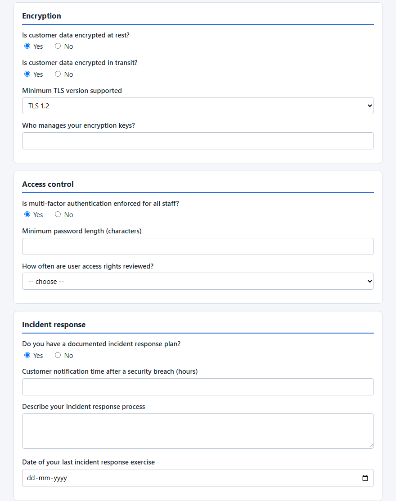
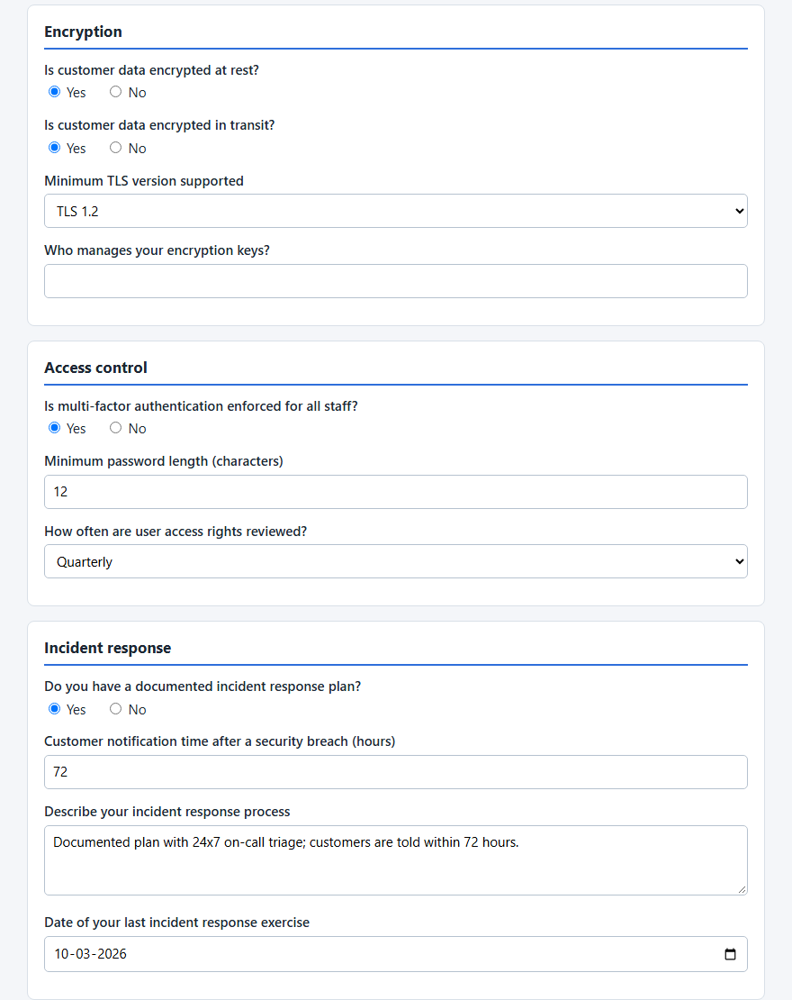
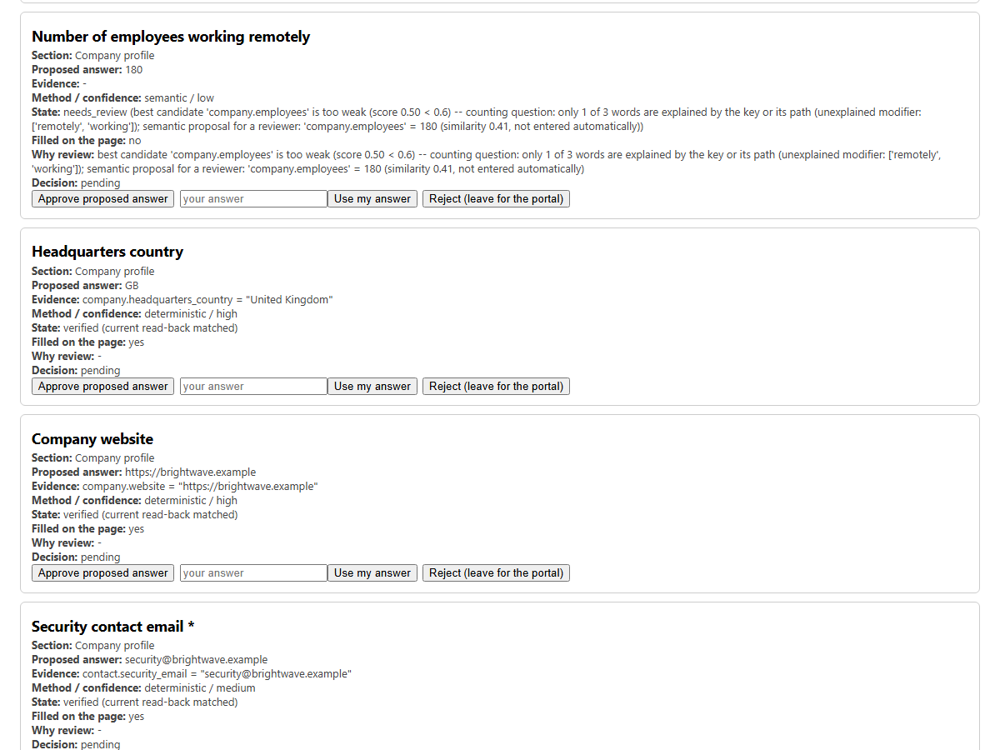
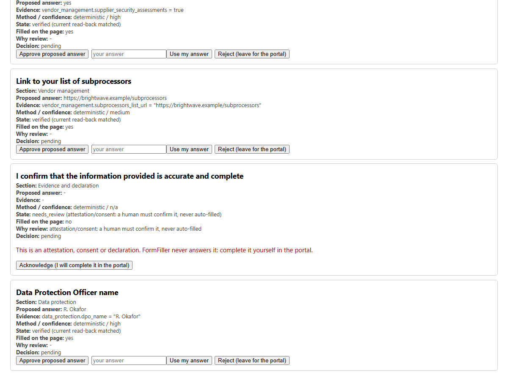
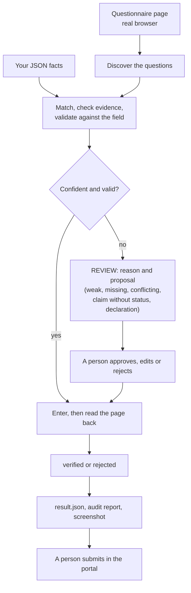

# FormFiller

[](https://github.com/niyabraham/FormFiller/actions/workflows/tests.yml)

**Fills vendor security questionnaires from your own JSON facts, checks every answer by reading the page back, and leaves everything it is unsure about to a person. It never submits a form by itself.**

FormFiller is a Python prototype for web-based **Requests for Information (RFIs)** such as vendor and security questionnaires. It reads the form in a real browser (Playwright), finds the answer in a JSON file of facts about your company, validates it against the field, types it in, and reads the page back to confirm. When it is not sure, it leaves the field alone and shows a person the evidence it found.

> **Status: a tested prototype.** Measured on local fixtures, on pre-written ground truth, and on ten public demo and template forms. It has **not** been proven on real company RFI portals and is **not** claimed to work on every website ([limitations](#limitations)). Final submission is always a human action.

## Key capabilities

- **Answers only from evidence.** Every answer carries the source path it came from, the method that produced it and a confidence category (`high` or `medium`).
- **Abstains instead of guessing.** No match, a weak match, two plausible answers, a contradiction in your own data, a certification claim without a stated status, another entity's fact, a value the field cannot take, a disabled field or a declaration all become a `REVIEW` item with a reason, the candidates it saw, and sometimes a *proposal* that is never entered automatically.
- **Verifies by reading the page back.** `verified` means the live control was read back after a short confirmation window and matched. Values the page clears, changes or rejects are reported as failures.
- **Human review that cannot submit.** A local, token-protected page to approve, edit or reject each answer. A declaration or consent can only be acknowledged, never answered by software.
- **Tested control patterns.** Text, textarea, email, url, tel, number, date, colour, select, radio and checkbox groups, styled radios and checkboxes, react-select-style dropdowns, ARIA comboboxes, open shadow DOM, same-origin iframes, late-rendering pages and conditionally revealed fields ([compatibility matrix](docs/COMPATIBILITY.md)).
- **Multi-step forms (opt-in).** A navigation state machine presses only recognised Next buttons, checks that each press really moved forward, stops on loops, validation errors and redirects, and blocks the browser's network during the walk (not absolute isolation: see [limitations](#limitations) and the [security model](docs/SECURITY_MODEL.md)).
- **Save, resume and audit.** A versioned progress file for interrupted runs, and a per-run `result.json`, Markdown audit report and screenshot.
- **Deterministic by default.** No machine-learning models and no external services unless you install and enable the optional layers.

<details>
<summary>Everything that is implemented, in full</summary>

Everything below is implemented and covered by automated tests on local fixture pages (`docs/COMPATIBILITY.md` has the full matrix).

- Supported controls: text, textarea, email, url, tel, number, date, colour, select, radio groups, checkbox, checkbox groups, and ARIA comboboxes (tested patterns only). Styled radios and checkboxes (a hidden input under a clickable label) are set through their own label, never forced; a react-select-style dropdown is read back from the value it displays; an open date-picker popup is not mistaken for questions. Open shadow DOM, same-origin iframes, late-rendering pages, conditionally revealed fields.
- Layered matching with provenance on every answer and proposal (`method`, `source`, `confidence_category`, `conflicts`, `validation`) and abstention instead of guessing.
- Multi-step walks: client-side wizards, server-backed single-page apps and server-rendered (form POST) wizards, with every transition recorded; Back re-verification; loop, no-change, validation-error and redirect detection; required-field gate.
- Network guard during walks, with an explicit allow-list policy for portals that must reach their server between steps; every relayed request is recorded, and requests carrying entered answers need explicit permission.
- Field-level and questionnaire-level verification: read-back, values the page clears or rejects, choices that undo each other, a review summary (required questions still open, conflicts, attestations, blocked actions).
- Human review: a local, token-protected review page to approve, edit or reject each answer; decisions are re-validated and applied on the next run. Approving is not a signature and not a submission.
- Save and resume: a versioned progress file; on resume every restored value is read back from the page, and a value that changed since is left for review, never overwritten.
- Audit report per run (`audit_report.md`), with optional redaction of the answers.
- A non-submitting validation tool for pages you are allowed to test.
- A legacy PDF proof of concept (`formfill/*.py`, `demo.py`) that preceded the web pipeline.

</details>

## Demo

A fictional eight-section vendor security questionnaire (33 questions) and a fictional company file. Once installed it runs locally in about ten seconds, with no API key and no network access:

```bash
git clone https://github.com/niyabraham/FormFiller.git && cd FormFiller
python -m venv .venv && source .venv/bin/activate      # Windows PowerShell: .venv\Scripts\Activate.ps1
pip install -e ".[web]" && playwright install chromium
python demo_web.py --form docs/demo/security_questionnaire.html --source docs/demo/company_source.json --out output/demo
python -m formfill.web.review_server output/demo/result.json --build    # the local review page; then re-run with --review
```

| After the first run | After a person's decisions in the review page |
|---|---|
|  |  |

*Both are the same region of FormFiller's own `filled.png` screenshots, cropped and not otherwise edited.*

First pass: **22 answers entered and verified**, each with its source; **11 questions left for a person**, each with a reason (no fact, a contradiction in the source, SOC 2 only "in progress", a declaration, ...); **1 file upload** reported and never touched. After the reviewer approves, edits or rejects: **29 verified, 4 still with the person, nothing submitted.** These counts describe this hand-written fixture, which was written to show every behaviour. They are not an accuracy figure; see [Evaluation results](#evaluation-results).

| The review page: a refused near-miss with only a low-confidence proposal | A declaration: only "acknowledge" is offered |
|---|---|
|  |  |

Step-by-step guide with expected output, known limitations and troubleshooting: [`docs/demo/DEMO_GUIDE.md`](docs/demo/DEMO_GUIDE.md). A three-minute recording script: [`docs/demo/RECORDING_SCRIPT.md`](docs/demo/RECORDING_SCRIPT.md). The smaller original example still runs with `python demo_web.py`.

## How it works



1. **Read the source data.** Your JSON file is flattened into a list of facts (for example `company.legal_name = "Brightwave Systems Ltd"`). It is the only knowledge base: FormFiller never invents an answer.
2. **Discover the form.** Playwright opens the page and lists every visible control with its label, section, type, options and whether it is required. Hidden controls are not asked.
3. **Match an answer, in layers** ([`docs/MATCHING.md`](docs/MATCHING.md)):
   - exact and normalised word matching, with domain terms (SOC 2, ISO 27001, PCI DSS, BCP, RTO, RPO, 2FA, ...) and guards for scope, period, entity names, topic and **neighbouring concepts** (a question and a fact that differ by one word, such as RPO and RTO, are never treated as the same: [how](docs/MATCHING.md#neighbouring-concepts-rpo-is-not-rto));
   - evidence checks: a certification or compliance claim ("Are you SOC 2 certified?") is answered only from a stated status, a subsidiary's or parent's fact is never used for the company, and facts that contradict each other send the question to review;
   - similarity search, and optionally an LLM, can only **propose** an answer for a person to approve; they never enter one.
4. **Validate** the value against the control: numbers and ranges, dates and their shown format, e-mail and URL formats, allowed options, length limits, hex colours.
5. **Plan.** Each question becomes `ANSWER` (value, source path, method, confidence category) or `REVIEW` (reason, candidates, and any proposal). Only the plan reaches the browser.
6. **Fill and verify.** Only `ANSWER` items are entered; the page is read back after a short wait. Each field ends in one state: `proposed`, `entered`, `verified`, `rejected`, `skipped` or `needs_review`.
7. **Multi-step forms** (opt-in): a navigation state machine presses recognised Next buttons, checks that each press really moved to a new step (and detects loops, no change, validation errors and redirects), stops before Next while a required question is open, and can go Back to re-verify earlier answers. The browser's network is blocked during the walk unless explicit rules allow named requests ([`docs/SECURITY_MODEL.md`](docs/SECURITY_MODEL.md)). The final submit step is never pressed.
8. **Report.** `result.json`, a Markdown audit report and a screenshot. Optional: a progress file to resume an interrupted walk, and a review file with a person's decisions, edited on a local review page.

The components, the data flowing between them, where each abstention decision is made and what is not implemented are in [`docs/ARCHITECTURE.md`](docs/ARCHITECTURE.md).

## Safety and human-in-the-loop design

- **The default never submits, and final submission is a human action.** Submission happens only if the caller passes `submit=True` to `run_form`, and never after a multi-step walk. FormFiller leaves the form filled and unsubmitted; you check it and submit it yourself in the portal. The validation tool and the review page have no submit option at all.
- **Uncertain answers go to `REVIEW`:** no match, a weak match, two plausible answers with different values, contradicting facts, a certification or compliance claim without a stated status, another entity's fact, a value that fails validation, disabled controls, and attestations. An attestation is wording in which the respondent agrees, consents, declares, certifies, signs, authorises something, or vouches that the form is accurate; it is detected on any control type and is never answered from the source data (the review page only lets a person acknowledge it, to complete in the portal). The detection is wording-based; see [limitations](#limitations).
- **Proposals are never answers.** Similarity and LLM suggestions appear as `proposed_answer` on a `REVIEW` item (and as "proposed, not entered" in the audit report) until a person approves them. Some proposals are irrelevant, which is why they are never entered automatically.
- **Controls it cannot fill are reported, never touched:** file uploads, password fields, `contenteditable` regions, custom ARIA widgets (textbox, listbox, slider and similar), and signature-style canvases. A run with any of them is never `FILLED`.
- **Submission is refused** (when `submit=True`) if any answer failed or was never entered, a required item needs review, an attestation is open, the page never settled, a walk stopped early, or an unsupported control is present (an optional one can be acknowledged by its `ack_id` in `acknowledge_unsupported`; a required one always blocks).
- **Multi-step navigation never presses a submit-type button, a link that leaves the page, or a button labelled Submit, Send, Sign, Certify, Accept, Finish and similar,** and never accepts browser dialogs. A submit-type Next is pressed only when an explicit `form_navigation` rule covers that form.
- **The browser's network is blocked during a walk, on the channels that were tested. This is not absolute network isolation** ([`docs/SECURITY_MODEL.md`](docs/SECURITY_MODEL.md) lists what is blocked, what is permitted, what was not tested and what cannot be guaranteed). By default nothing is let out; with a `NetworkPolicy`, only requests matching an explicit rule are relayed, the browser itself stays offline, and every relayed request is recorded. Any blocked attempt stops the walk and keeps the status at `NEEDS_REVIEW`. The block stays on after the run until the browser context closes or `release_wizard_network_guard(page)` is called after review. A plain one-page run, like the demo, does not use this guard.
- **A value shown in the page is not proof of saving.** FormFiller checks the page, not the server, and never claims a form was saved or submitted unless the page shows a confirmation text you supplied.
- **Artifacts are protected:** written atomically, owner-only on POSIX systems, with URLs reduced to scheme, host and path. Progress and result files hold no cookies or tokens. Playwright traces are off by default; when requested, cookie and authorization values are removed from them. Generated output is git-ignored.
- **Optional AI services stay optional.** Nothing leaves the machine unless code enables the LLM layer and `FORMFILL_LLM_ALLOW_EXTERNAL=1` confirms it ([setup](#installation-and-development-setup)).

## Evaluation results

**Last checked on 1 Nov 2026, code at `main` `f463eb4` (PR #27, the neighbouring-concept fix, merged) plus the portfolio changes; earlier figures were re-measured on the dates in [`docs/PROGRESS.md`](docs/PROGRESS.md).**

Each table below is a separate evaluation on a separate set. They are **not** combined into one score. Definitions: *precision* is correct answers divided by answers entered; *coverage* is correct answers divided by the questions that have a correct answer in the source; a *wrong answer* (wrong fill, "unsafe") is an answer that was entered and was wrong; an *abstention* is a question left for a person, which is *correct* when the source holds no answer and a *missed answer* when it did; *verified* means entered and read back from the page.

### Answer matching: precision, coverage, wrong answers, abstentions

| Set | Precision | Coverage | Wrong answers | Left for a person |
|---|---|---|---|---|
| RFI development set (`benchmarks/rfi`, 192 questions, browser) | 98.1 % | 55.7 % (105 correct); before this work 98.0 %, 52.6 % | 1, the known disputed label recorded before this work | 38.0 % of questions sent to review |
| Second set (`benchmarks/heldout`, 272 questions, browser) | 100 % | 40.1 % (109 correct); before 100 %, 39.3 % | 0 | 48.2 % sent to review |
| Matching layers, `benchmarks/semantic` eval set (30 cases, no browser; written and hashed before the layers existed) | 1.00 | 0.71; before 0.78, 0.41 | 0 unsafe (before: 2); 4 of 4 proposals right | 18 of 30 abstained: 13 correct, 5 missed answers |
| Ten public demo and template forms x 2 fictional sources (`tools/evaluate_realworld.py`, ground truth written before the answers were looked at; nothing submitted; [report](REAL_WORLD_TESTING_REPORT.md)) | 100 % (10 of 10) | 59 % (10 of 17); a small sample on public forms, not company portals | 0 wrong fills; baseline before the RW-1 and RW-2 fixes: 62 % precision, 59 % coverage, 6 wrong fills | 129 correct abstentions, 7 missed answers |

**The second set is not an untouched, independent evaluation.** It was frozen before it was first run, but it has since been used to guide fixes, including the exclusion rules of PR #27, which were adjusted after comparing per-question decisions on it; its figures show that no decision changed, not that the rules generalise to unseen forms. The semantic eval set was written by the same author as the development set; see [`docs/MATCHING.md`](docs/MATCHING.md) for what that means. On both browser matching benchmarks every changed decision went from a missed answer to a correct one.

### Neighbouring concepts (PR #27): regression probes and what else changed

A question and a fact that differ by one word ("recovery *point* objective" against `rto_hours`) used to be answered from the wrong fact. Four separate measurements, none of them a benchmark of the fix's generality:

| Measurement | Before PR #27 | After |
|---|---|---|
| 62 related-concept probes written for this change (RPO/RTO, encrypted in transit/at rest, authentication/authorization, backup frequency/retention, data deletion/retention, incident response/notification time, minimum/maximum, ...); counted as *wrong automatic answers* | 23 | 0 |
| Targeted regression tests (`tests/web/test_concept_confusion.py`, 130 tests) | 47 of the first 121 failed on the old code | all pass |
| Development and second set (automatic answers; table above) | 105 and 109 correct | identical: no question changed decision |
| 32 recorded real-world control sets (221 questions), re-planned offline: answered fields | 29 | 29, identical answers |

Limits of this evidence: the probes were written by the author of the fix, cover only the pairs that came to mind, and one probe is still a lost match that was already lost before; the probe outputs are kept in [`benchmarks/results/`](benchmarks/results/2026-11-01_neighbouring_concept_guard/README.md) (the probe script itself was a scratch tool and is not in the repository, the 130 tests are). Reviewer *proposals* are measured separately from automatic answers and are not fill precision: 11 proposals changed in the real-world replay, 8 removals were right (for example a company name offered for "Full name"), 2 plausible proposals were removed ("Contact email" is no longer offered the CISO's address) and 1 became worse ("Readonly input" is now offered a date of birth). Proposals are never entered automatically.

### Navigation and safety behaviour (fixtures, not real websites)

These use fictional forms written by the project. Results show behaviour on those forms only.

| Evaluation | Result |
|---|---|
| Wizard navigation and safety (`tools/evaluate_wizards.py`, 16 scenarios) | 16 of 16 expected outcomes, 0 final submissions, 0 requests reaching the server without a relay record, 0 answers sent without permission |
| Multi-step and SPA fixtures (`tools/evaluate_spa.py --policy`, 26 fixtures) | 0 crashes, 0 submit events, 0 submissions, 0 dialogs accepted, 11 of 12 expected safe stops, 1 of 3 planted resets detected, 77 of 82 controls discovered |
| Widget fixtures (`tools/evaluate_widgets3d.py`) | 12 of 12 expected fields filled and read back, 3 of 3 conditional fields found |

The SPA row is unchanged since the network guard was added: three fixtures stop at their first network request or page reload (`outbound_request_blocked`), so their later steps and planted resets are not reached. That is the block working as designed; the expected results were not edited.

### Browser mechanics only (kept apart from the matching figures)

| Evaluation | Result |
|---|---|
| Public demo forms, mechanics only (custom dropdowns, styled checkboxes, date picker, conditional fields; its own source and scoring, never mixed with the matching rows above) | 21 expected fills: 19 confirmed by read-back, 0 failed, 2 blocked by design; the page held 18 of 20 expected values; 0 wrong fills |

### Automated tests (local fixture pages)

- Windows 11, Python 3.12, Playwright 1.64.1 with its Chromium, `FORMFILL_REQUIRE_BROWSER=1`, in a fresh virtual environment on a clean checkout of `main` `f463eb4` plus the portfolio files: **1534 passed, 2 expected failures (xfail), 0 failed, 0 skipped** (`python -m pytest -q`, about 15 minutes). That is 1508 on `main` itself plus 26 in `tests/web/test_demo_rfi.py`. Before PR #27 and the demo tests: 1378 passed, 2 xfailed; before the RFI completion work: 1123 passed, 2 xfailed.
- Linux (Ubuntu 24.04 under WSL), Python 3.11, Playwright 1.64.1, same strict mode: 1252 passed, 2 xfailed, 0 failed, 0 skipped. That run is from an earlier commit and was not repeated for the later changes; CI runs the suite on Python 3.11 and 3.12 for every pull request.
- Playwright 1.48.0 (the oldest supported version), Linux: the network-guard, wizard, policy, progress and review tests pass.
- `ruff check formfill tools tests benchmarks`: no findings. `mypy` (settings in `pyproject.toml`): no issues. `pip-audit --skip-editable` in a fresh environment built from `pip install -e ".[dev]"`, **after `python -m pip install --upgrade pip`**: no known vulnerabilities. (pip-audit checks every package in the environment it runs in, pip included: the pip 24.3.1 that Python 3.12.8 bundles into a new virtual environment is reported with 12 known vulnerabilities until it is upgraded, and an older, long-lived global Python reported findings in out-of-date packages. None is a FormFiller dependency.) No code formatter is configured.
- The two expected failures are a disputed company-versus-subsidiary label in the benchmarks, kept as strict `xfail` (they fail the run if they start passing).
- The demo in [`docs/demo`](docs/demo/DEMO_GUIDE.md) is pinned by `tests/web/test_demo_rfi.py`, so the outcomes quoted in the guide cannot drift from the behaviour.
- CI (`.github/workflows/tests.yml`) runs on pull requests and on pushes to `main`; its result for a branch is shown on its pull request.

To reproduce the evaluations (they need `--out-dir` and write nothing into `benchmarks/`):

```bash
python tools/evaluate_baseline.py --out-dir output/eval_dev
python tools/evaluate_baseline.py --bench-dir benchmarks/heldout --out-dir output/eval_heldout
python tools/evaluate_matching.py --out-dir output/eval_matching          # no browser; dev and eval sets
python tools/evaluate_wizards.py --out-dir output/eval_wizards
python tools/evaluate_spa.py --policy --out-dir output/eval_spa
python tools/evaluate_realworld.py run --out-dir output/realworld          # needs the network; then: score --out-dir output/realworld
```

## Real-world compatibility

What was run against real pages (fictional data, nothing submitted) and what that shows:

- **Ten public demo and template forms (plus four supplemental variants), two fictional sources each** (OpnForm templates, 123FormBuilder, SurveyJS examples, Form.io's wizard, DemoQA's practice form and Selenium's test form, some of them multi-page). The first run measured precision 62 % and coverage 59 % with six wrong fills, from two root causes. After fixing those two (RW-1, RW-2): precision 100 % (10 of 10), coverage 59 % (10 of 17), no wrong fills. Five more problems found in the browser mechanics were also fixed (RW-10 to RW-14). **Seven findings (RW-3 to RW-9, medium and low) are documented and not fixed**, among them that a plain one-page run has no network guard (RW-6) and that third-party tracking requests can stop a guarded walk (RW-5; 123FormBuilder's own analytics and chat beacons did, and every one of their write requests was blocked). Evidence, root causes and status are in [`REAL_WORLD_TESTING_REPORT.md`](REAL_WORLD_TESTING_REPORT.md).
- **Browser mechanics on the same kind of pages, scored separately:** react-select dropdowns, styled checkboxes, a date picker and conditional fields: 19 of 21 expected fills confirmed by read-back, the other two blocked by design.
- **Selenium's public test form, re-run on 29 Oct 2026:** 11 controls found, plus 2 reported as unsupported (password, file upload). Text, textarea, colour, date and range were filled and verified; the two dropdown questions and the checkbox and radio groups went to `REVIEW`; status `NEEDS_REVIEW`, nothing submitted.
- **QA practice form (`qapractice.com`), owner's earlier runs, not re-run:** 11 controls; 10 answered and 9 verified. One choice (radios without a `name`) could not be verified. The run ended `FAILED`.
- **HelloForms vendor-questionnaire template, owner's earlier run, not re-run:** a text answer typed right after page load was cleared about 1.5 s later by the page's own framework. In the later full run, 3 answers were verified and the automatic re-entry did **not** trigger, so that recovery is tested on a local fixture only.

These show the pipeline running on public practice and template pages. They are not evidence that it works on real company portals, and they do not show that any given website, or every website, is supported. The supported patterns and their limits are in [`docs/COMPATIBILITY.md`](docs/COMPATIBILITY.md).

## Limitations

- **Not validated on real RFI portals.** No company portal, login, or real multi-step questionnaire has been tested.
- **Multi-step walks need the portal's cooperation.** By default every request is blocked, so a portal that loads steps, validates fields or autosaves through its server stops with `outbound_request_blocked` unless you write allow rules for those endpoints. Single sign-on, CAPTCHA, login and payment pages are never handled.
- **One-page runs are not network-guarded.** The network block belongs to multi-step walks. A plain `run_form(page, source)` on one page, which is what the demo does, does not block the page's own requests (RW-6 in the real-world report, open); it also never submits unless you pass `submit=True`.
- **The network block has gaps** ([`docs/SECURITY_MODEL.md`](docs/SECURITY_MODEL.md)): connections the page opened before the walk are not closed, requests the page makes before the walk starts are not blocked, a `SharedWorker` made with a constructor the page kept from before the walk and a `blob:` script can send before it is noticed, the DevTools-based layers need Chromium, offline emulation is context-wide and can make a page stop the walk, and only Playwright 1.48.0 and 1.64.1 with their Chromium builds were measured.
- **Matching is conservative by design, and still not perfect.** Coverage is about half on the development set and 40 % on the second set; a correct fill is only as good as the source data. Similarity proposals depend on spelling and the synonym table unless a local embedding model is configured, and some are irrelevant: in the demo, three of six proposals do not answer their question.
- **Concept confusion is guarded, not solved.** The matcher compares words. A question and a fact that differ by exactly one word (RPO/RTO, encrypted in transit/at rest, authentication/authorization) are no longer treated as the same (PR #27): with no RPO fact the RPO question goes to review instead of being answered with the RTO value ([demo guide](docs/demo/DEMO_GUIDE.md#7-known-limitations-seen-while-preparing-this-demo) shows it). The guard sees a one-word swap per side plus a topic rule, its exclusion lists are short and were built from observed cases, and it was checked on probes written for it. A swap that also changes a second word, or a pair nobody thought of, can still be answered from the wrong fact. It also removed two plausible reviewer proposals and made one worse ([known gaps](docs/MATCHING.md#known-gaps-found-on-the-eval-set-deliberately-not-tuned)).
- **Matching is sensitive to wording.** `notify` and `notification`, `apply` and `applicable`, or a hyphenated `sub-processor` and `subprocessor` are different words to it. These cases fail safe, going to review, but they lower coverage; key your source in the questionnaire's own words.
- **Attestation detection is wording-based.** A genuine attestation phrased in an unexpected way, on a free-text or number field, is answered like any other question; some factual yes/no questions with unusual wording go to review.
- **Detection of unsupported controls is by markup.** A widget built from plain `div`s with no ARIA role is not seen; controls in cross-origin iframes or closed shadow roots are not inspected; datalist options are not read. `role=checkbox` and `role=switch` widgets are reported, not filled; a native input hidden with `display:none` is not discovered.
- **Custom widgets are handled by structure, on few examples.** A react-select-style dropdown is recognised by the class names of its displayed value; a date-picker popup by its class names or a date/calendar dialog label (English month names). Other libraries are untested. A react-datepicker popup left open by a typed date is closed with one Escape in the field when that cannot close anything else; other pickers' popups are left open, and a control they cover is refused and reported (see [`REAL_WORLD_TESTING_REPORT.md`](REAL_WORLD_TESTING_REPORT.md), section 15).
- **Compatibility is measured on public demo forms only.** The real-world evaluation covers 10 public demo and template forms (some of them multi-page) with fictional data. It shows what works and what does not on those pages; it does not show that any given website, or every website, is supported. Third-party trackers on a page can stop a guarded walk.
- **Page behaviour is only partly handled.** Fields that appear well after an interaction can be missed, a reset after the confirmation window is not seen, and the single re-entry recovers React/Vue/Svelte patterns only. Next buttons inside shadow roots or iframes are not found.
- **Saving is not confirmed.** A correct read-back does not prove the server stored the value.
- **The review page is for one local reviewer.** It has no accounts, no audit of who decided, and no concurrent editing.
- **Windows file permissions** are inherited from the output folder; only POSIX systems get owner-only files automatically.
- **No logging module.** Runs are explained through `result.json`, the audit report and warnings.

## Installation and development setup

```bash
python -m venv .venv
source .venv/bin/activate          # Windows: .venv\Scripts\activate  (PowerShell: .venv\Scripts\Activate.ps1)
python -m pip install --upgrade pip   # the pip bundled with a new venv can be old enough for pip-audit to report it
pip install -e ".[dev]"            # ".[web]" is enough to run the demo; add ,semantic or ,llm for the optional layers
playwright install chromium
python -m pytest -q                # set FORMFILL_REQUIRE_BROWSER=1 to make a missing browser an error instead of a skip
```

Python 3.11 or newer. Playwright 1.48 or newer is required (the network guard uses WebSocket routing); the guard measurements were made on 1.64.1 and, for the guard tests, 1.48.0.

| environment variable | effect |
|---|---|
| `FORMFILL_CHROMIUM` | path of a Chromium executable to use instead of Playwright's |
| `FORMFILL_REQUIRE_BROWSER=1` | browser tests fail instead of being skipped when Chromium cannot be launched (CI sets it) |
| `FORMFILL_EMBEDDING_MODEL` | directory of a local sentence-transformers model for similarity proposals (needs `.[semantic]`); falls back to the built-in backend if it cannot be loaded |
| `FORMFILL_LLM=anthropic` and `FORMFILL_LLM_ALLOW_EXTERNAL=1` | read by `llm.reranker_from_env()`, which code passes as `MatcherConfig(reranker=...)`; sends the question text and candidate key paths to Anthropic's API (the SDK reads `ANTHROPIC_API_KEY`). `FORMFILL_LLM_SEND_VALUES=1` also sends the candidate values; `FORMFILL_LLM_MODEL` picks the model. Without the confirmation variable it refuses to start |

Quality checks, as CI runs them: `python -m ruff check formfill tools tests benchmarks`, `python -m mypy`, `python -m pip_audit --skip-editable`, and `python -m pytest -q`.

| Technology | Purpose |
|---|---|
| Python 3.11+ | All code |
| Playwright (Chromium) | Opens pages, reads controls, fills and reads back, walks wizards |
| JSON | Source data, results, progress and review files |
| pypdf | The legacy PDF proof of concept only |
| pytest, ruff, mypy, pip-audit | Tests, lint, type checking, dependency audit |
| sentence-transformers (optional, `.[semantic]`) | A local embedding model for similarity proposals; never downloaded at run time |
| anthropic (optional, `.[llm]`) | An LLM second opinion that only proposes; off unless explicitly enabled; tested with a fake client only |
| GitHub Actions | Lint, types, dependency audit, matching report; tests on Python 3.11 and 3.12 with Chromium required; wizard navigation report |

## Usage

All examples use fictional data and local pages.

```bash
python demo_web.py        # the small example: fills examples/web/rfi_form.html; never submits unless you add --submit
python demo.py            # the older PDF proof of concept
python -m pytest -q       # the automated tests
```

`demo_web.py` writes `output/web/result.json`, `audit_report.md` and `filled.png` (and `trace.zip` with `--trace`). It ends `NEEDS_REVIEW` because the sample page asks questions the sample data does not answer. With `--form`, `--source`, `--out` and `--review` it runs the larger [demo](docs/demo/DEMO_GUIDE.md); `--trace` adds a Playwright trace.

To try a page you are allowed to test (never submits; use fictional data only):

```bash
python tools/validate_public_form.py --url https://example.test/form --source my_fictional_source.json \
    [--policy] [--confirm-ms 1000] [--out-dir output/public_validation] [--trace]
```

Source keys should resemble the form's wording (for example `company.legal_name` for "Legal name"). `--policy` walks multi-step forms with the network blocked, so a portal that loads its next step from its server stops at `outbound_request_blocked`. Use `--confirm-ms 3000` or more on pages that start slowly. `--trace` also saves a Playwright trace, which holds the page content and the answers entered.

**In code:**

```python
from formfill.web.pipeline import run_form, release_wizard_network_guard
from formfill.web.steps import DiscoveryPolicy
from formfill.web.netpolicy import NetworkPolicy, AllowRule

result = run_form(page, source)                                     # one page; nothing is submitted
result = run_form(page, source, policy=DiscoveryPolicy(),          # a multi-step walk, network blocked
                  out_dir="output/run1", progress_path="output/run1/progress.json")
result = run_form(page, source, policy=DiscoveryPolicy(), progress_path="output/run1/progress.json",
                  resume=True)                                      # continue it later; restored values are read back
policy = NetworkPolicy(rules=(AllowRule(origin="https://portal.example", path="/api/section/*", note="load the next section"),))
result = run_form(page, source, policy=DiscoveryPolicy(), network_policy=policy)   # allow named requests only
release_wizard_network_guard(page)                                  # after a person has reviewed the result
```

`run_url(url, source_path, out_dir=..., trace=False)` launches Chromium itself.

**Resuming an interrupted run.** Pass `progress_path` to a multi-step run and FormFiller writes a versioned progress file after every verified step (owner-only where the OS allows; it holds your answers, but no cookies, tokens or credentials, and the target is stored as origin and path only). To continue, open the same form on the same origin and call `run_form(..., progress_path=..., resume=True)` within 72 hours (the default limit). Nothing in the file is trusted blindly: the form is discovered again, every saved answer is read back from the page, a field that already holds the saved value is not typed again, an empty one is filled as normal, and one that now holds something else is left alone and goes to review. A file that is stale, from another origin, or ambiguous is refused or stops the walk for review. `run_form` will not overwrite an existing progress file unless `resume=True`.

**Reporting and audit artifacts.** With `out_dir`, a run writes `result.json` (every question with its state, source path, method, confidence, validation, read-back and reason; unsupported controls; the navigation record; the review summary), `audit_report.md` (the same for a person, with `redact_report=True` hiding the answers), and a screenshot `filled.png`. A Playwright trace is written only on request and is scrubbed of cookies and authorization values. The review page writes `review.json`. Output folders are git-ignored; they contain your answers, so treat them as confidential.

**Human review:**

```bash
python -m formfill.web.review_server output/run1/result.json --build   # prints http://127.0.0.1:<port>/?token=...
```

Decisions are saved to `review.json` next to the result. Apply them on the next run with `run_form(..., planner=decisions_planner(load_review("output/run1/review.json")))` (`formfill/web/review.py`), or with `python demo_web.py ... --review output/demo/review.json` for the demo; each decision is re-validated against the control first, and an approval goes back to review if the proposal it approved has changed since or the value no longer fits the field.

**Source data.** Any JSON object holding facts about the company; nesting is fine and keys should resemble the wording of the questions they answer (see [`docs/demo/company_source.json`](docs/demo/company_source.json) and `examples/web/rfi_source.json`):

```json
{ "company": { "name": "Acme Corp", "employees": 250, "website_url": "https://acme.example" },
  "security": { "contact": { "email": "security@acme.example" } },
  "certifications": { "iso_27001": { "status": "certified" } } }
```

Add keys only for facts you can stand behind. A certification is answered "Yes" only from a stated status such as `certified`, `true` or `compliant`; `in progress`, `planned` or a mere mention leads to review. Attestations are never answered from the source, so keys such as `terms_accepted` are not used.

**Statuses** ([`docs/OUTPUT_DESIGN.md`](docs/OUTPUT_DESIGN.md) has the exact rules): `FILLED` (everything answered and verified, nothing submitted), `NEEDS_REVIEW` (a person must act), `FAILED` (a fill or read-back failed, or the page rejected a value), `SUBMITTED` / `SUBMITTED_UNCONFIRMED` (only after `submit=True` and every check passed).

## Project structure

- `formfill/web/` is the web pipeline ([`docs/ARCHITECTURE.md`](docs/ARCHITECTURE.md)):
  - reading the form: `discover.py`, `understand.py`, `tokens.py`;
  - matching: `retrieve.py` (scores facts), `evidence.py` (claims, conflicts), `semantic.py` (proposals), `llm.py` (optional), `matching.py` (configuration, confidence categories), `plan.py` (ANSWER or REVIEW), `validate.py`;
  - filling: `execute.py`, `verify.py`;
  - multi-step: `navigation.py` (state machine), `steps.py` (Next/Back rules), `guard.py`, `netpolicy.py`, `sharedworkers.py` (network guard);
  - results: `result.py` (states, summary), `report.py` (audit report), `progress.py` (resume), `review.py` and `review_server.py` (human review), `artifacts.py` (safe writing);
  - `pipeline.py` runs everything (`run_form`, `run_url`).
- `formfill/*.py`, `demo.py`: the older PDF proof of concept.
- `demo_web.py`, `docs/demo/`: the demo script, the fictional questionnaire and source, the guide and the recording script. `docs/assets/`: real screenshots from the demo.
- `tests/`: automated tests; `tests/web/fixtures/` holds small HTML pages used by them; `tests/web/test_concept_confusion.py` is the regression suite for neighbouring concepts, `tests/web/test_demo_rfi.py` pins the demo.
- `benchmarks/`: fictional forms with expected answers: `rfi/` (development set), `heldout/` (second set), `semantic/` (matching dev and eval sets), `spa/` (browser fixtures), `wizards/` (multi-step fixtures, local server and scenarios), `realworld/` (public-page ground truth and recorded results), `results/` (dated before/after results of the neighbouring-concept fix).
- `tools/`: evaluation scripts and `validate_public_form.py`.
- `examples/`: fictional sample data and a small local sample RFI page.
- `docs/`: see below.

## Documentation

| Document | What it covers |
|---|---|
| [`docs/demo/DEMO_GUIDE.md`](docs/demo/DEMO_GUIDE.md) | Step-by-step demo with expected output, known limitations and troubleshooting |
| [`docs/demo/RECORDING_SCRIPT.md`](docs/demo/RECORDING_SCRIPT.md) | A three-minute presentation script |
| [`docs/ARCHITECTURE.md`](docs/ARCHITECTURE.md) | Components, data flow, decision points, what is not implemented |
| [`docs/SECURITY_MODEL.md`](docs/SECURITY_MODEL.md) | What the network guard blocks, permits, monitors and cannot guarantee |
| [`docs/COMPATIBILITY.md`](docs/COMPATIBILITY.md) | Supported widgets and patterns, their limits and the tests behind them |
| [`REAL_WORLD_TESTING_REPORT.md`](REAL_WORLD_TESTING_REPORT.md) | Testing on public pages: method, findings, fixes and what is still open |
| [`docs/MATCHING.md`](docs/MATCHING.md) | How matching is layered, calibrated and measured |
| [`docs/OUTPUT_DESIGN.md`](docs/OUTPUT_DESIGN.md) | The result format and its rules |
| [`docs/PROGRESS.md`](docs/PROGRESS.md) | The implementation log and measurements over time |
| [`docs/INTERVIEW_GUIDE.md`](docs/INTERVIEW_GUIDE.md) | A technical walkthrough for explaining the project: introduction, architecture, design trade-offs, likely questions and honest limits |
| `docs/PHASE*_EVALUATION.md`, `docs/HELDOUT_*.md`, `docs/TECH_STACK_COMPARISON.md`, `docs/GITHUB_LANDSCAPE.md` | Earlier design notes and evaluation reports |

## Future improvements

- Validate on real, permitted multi-step portals, and with a test set written by someone else.
- Read datalist options; support more custom widgets and navigation inside shadow roots and iframes.
- A reviewed final-step workflow in which a person explicitly approves submission.
- Multi-reviewer review with identities and an audit trail.
- OS-level egress control (a proxy or firewall rule) as a stronger boundary than the in-browser guard.
- Protect against concept confusion beyond one-word swaps, and keep a probe set of confusable pairs in the repository.

## Behaviour changes in this version

- Matching (PR #27): a question and a fact that differ by one word (RPO / RTO, in transit / at rest, ...) are no longer treated as the same: the fact is not answered and not proposed. A key about a topic the question never names (retention, deletion, ...) needs more than half of the question explained, and a proposal is never a different kind of contact detail (a phone number for an e-mail question).
- `run_url` no longer records a Playwright trace by default (`trace=True` to ask for one); traces are scrubbed of cookie and authorization values. Reason: Playwright stores a portal's session cookie in the trace.
- A multi-step walk now stops before Next while a required question is unanswered (`required_unresolved`). `DiscoveryPolicy(advance_with_unresolved_required=True)` restores the old behaviour.
- Certification and compliance questions are answered only from a stated status; a source that merely mentions the standard now leads to review.
- `run_form` refuses to overwrite an existing progress file unless `resume=True`.
- Internal helpers moved out of `pipeline.py` into `guard.py`, `verify.py` and `navigation.py`; `run_form`, `run_url` and `release_wizard_network_guard` are unchanged and still importable from `formfill.web.pipeline`.
- `demo_web.py` gained optional `--form`, `--source`, `--out`, `--review` and `--trace` arguments and a per-section report. With no arguments it fills the same example page with the same outcome, but it no longer records a trace unless you pass `--trace` (a trace holds page content and the answers entered).
