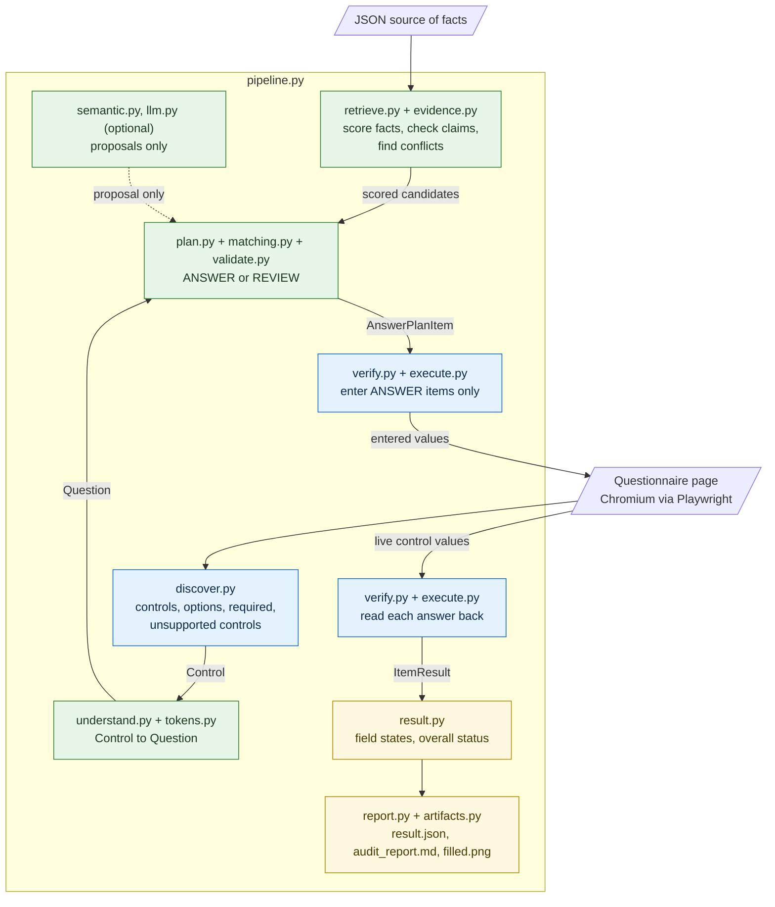
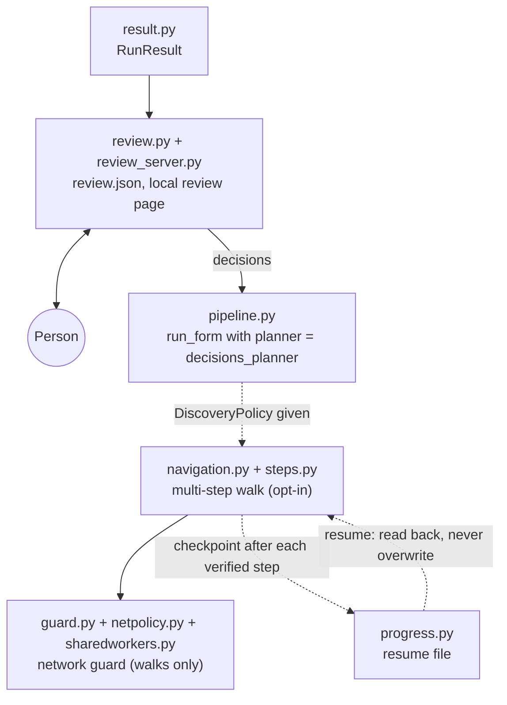
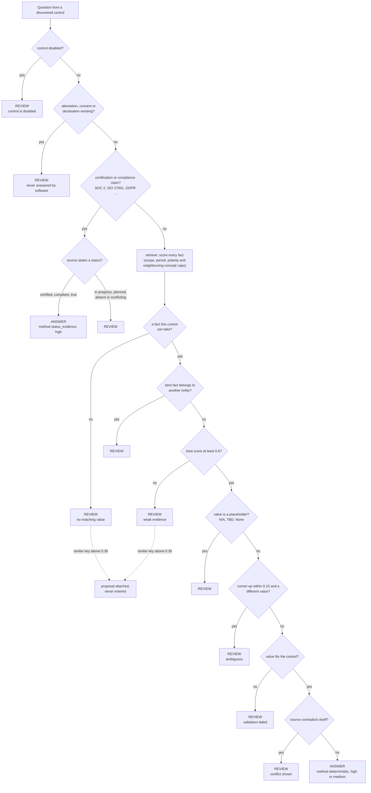
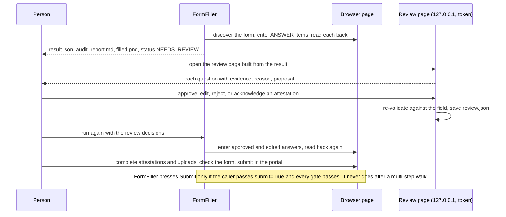

# FormFiller architecture

This document describes how the web pipeline in `formfill/web/` is built and how data moves through it. It describes what the
code does today; anything that is not implemented is listed in [section 11](#11-not-implemented). Module names are real, and
the diagrams were drawn from the modules' imports and call sites, not from the intended design.

## 1. Design in one paragraph

FormFiller works **form first, then source, then answers, then browser**. A questionnaire page is discovered with Playwright
and turned into a list of questions. Each question is matched against a flattened list of facts taken from a JSON file. A
deterministic planner then decides, per question, either `ANSWER` (a value, the source path it came from, a confidence
category) or `REVIEW` (a reason, the candidates it saw, and sometimes a proposal for a person). **Only the plan reaches the
browser**, and the reasoning code never imports Playwright. After typing, the page is read back, and a field counts as
`verified` only when that read-back matches. A person reviews everything that was not answered, and submission is never part
of the default flow.

Three principles recur throughout the code:

1. **Abstain rather than guess.** Every doubt (weak match, ambiguity, contradiction, missing status, another entity's fact, a
   value the control cannot take, an attestation) ends in `REVIEW` with a human-readable reason.
2. **A fill call is not evidence.** The only evidence that a value is on the page is a read-back of the live control.
3. **Software proposes, a person decides.** Similarity search and the optional LLM can only attach a *proposal* to a `REVIEW`
   item; entering a proposal needs an explicit human decision.

## 2. System diagrams

### 2.1 The core pipeline (one page)

`pipeline.py` (`run_form`, `run_url`) runs these steps in order. Green modules are the **reasoning layer**: they import no Playwright (checked from the imports of every module in `formfill/web/`), so
nothing in them can touch a page. Blue modules drive the browser. The only thing that crosses from green to blue is the
`AnswerPlanItem` list. `result.py`, `report.py` and `artifacts.py` also import no Playwright. Dashed arrows are optional.

### 2.2 Around the pipeline: review, multi-step walks, resume and the network guard

A person's decisions come back into the same pipeline as a replacement planner, so approved and edited answers are validated, entered
and read back exactly like automatic ones. A walk needs a `DiscoveryPolicy`; only then are the guard and the progress file used. The
LLM layer needs explicit configuration and, like similarity search, can only attach a proposal.

## 3. Components

| Component | Modules | What it does | Takes / produces |
|---|---|---|---|
| Source ingestion | `retrieve.index_source` | Flattens the JSON into `Leaf` facts: dotted path (`certifications.iso_27001.status`), value, and the normalised words of the key and its parents. Lists of scalars stay whole; nulls and empty values are skipped. | JSON object -> `list[Leaf]` |
| Form discovery | `discover.py`, `models.py` | Reads the live DOM (open shadow roots, same-origin iframes, ARIA comboboxes) into `Control` records: label, section, kind, options, required, constraints, visibility. Tags each control with a `data-ff-id` so it can be found again. Reports controls it cannot handle (`find_unsupported`). | Page -> `FormSchema` |
| Question understanding | `understand.py`, `tokens.py` | Turns a `Control` into a `Question`: cleaned text, the expected answer type (from the control, not the wording), and canonical concept tokens (SOC 2, ISO 27001, BCP, RTO ... are normalised on both sides). | `Control` -> `Question` |
| Retrieval | `retrieve.py` | Scores every fact against the question (precision and recall of the shared words), with guards that *cap* the score: a scope word the key lacks, a different time period, opposite polarity, and a *neighbouring concept* (a question and a key that differ by exactly one word, as "recovery point" and `rto_hours`' recovery time do). A capped candidate stays visible to a reviewer but can never be auto-answered. | `Question`, `Leaf`s -> ranked `Candidate`s |
| Evidence checks | `evidence.py` | A certification or compliance claim ("Are you SOC 2 certified?") is answered only from a *stated status*; a fact that merely mentions the standard, or an `in progress` / `planned` status, is not "yes". Contradicting facts about the same measure are reported as conflicts. | `Question`, `Leaf`s -> claim decision, conflicts |
| Proposals | `semantic.py`, `llm.py`, `matching.py` | For questions the deterministic layers left in review: a built-in lexical similarity search (offline, deterministic) and, only if explicitly configured, an LLM that can pick among the *same* gated candidates. Both only attach `proposed_answer`. | `REVIEW` item -> `REVIEW` item + proposal |
| Planning | `plan.py` | Applies the policy in [section 5](#5-where-confidence-and-abstention-decisions-are-made) and emits one `AnswerPlanItem` per question. The browser receives nothing else. | `Question`s -> `list[AnswerPlanItem]` |
| Validation | `validate.py` | Deterministic checks of a candidate value against the control's own constraints: number and range, date and its shown format, e-mail, URL, allowed options, length (never truncated), pattern. A value that does not fit is a `REVIEW`, not a coerced guess. | value, `Control` -> normalised value or reason |
| Browser execution | `execute.py` | Enters one validated answer per control kind (text, select, radio, checkbox group, ARIA combobox, date, ...) with Playwright actions: fill, select an option, check a box. A styled radio or checkbox whose input is covered is set by clicking its own label and reading the state back; it is never forced through page script. Text entries leave the field and wait for the page to settle. | `AnswerPlanItem` -> typed value |
| Read-back verification | `verify.py`, `execute.read_back`, `result.py` | Reads each control back from the page and compares it with the planned answer; records `verified`, the observed value and the browser's own validity. After the last entry the run waits a confirmation window (default 1 s) and reads again, so a page that wipes a field shortly after typing is reported. | live control -> `ItemResult` |
| Multi-step navigation | `navigation.py`, `steps.py` | An opt-in state machine for wizards: settle, fill, verify, gate, press one allow-listed Next, confirm the transition, re-verify. Stops on a loop, no change, a validation error, a redirect, a dialog, an unrecognised Next, or an unanswered required question. | `DiscoveryPolicy` -> step record |
| Network safety | `guard.py`, `netpolicy.py`, `sharedworkers.py` | During a walk, blocks the browser context's outbound requests on the channels that were tested; with an explicit `NetworkPolicy`, relays only named requests. See [section 9](#9-network-safety-scope). | `NetworkPolicy` -> blocked / relayed records |
| Human review | `review.py`, `review_server.py` | Builds `review.json` from a result, serves a local, token-protected page on `127.0.0.1`, records approve / edit / reject / acknowledge decisions after re-validating them, and feeds them back to `run_form` as a planner. | `RunResult` -> `review.json` -> planner |
| Progress and resume | `progress.py` | Writes a versioned progress file after each verified step. On resume the form is discovered again and every saved answer is read back; a value that already matches is not typed twice, an empty one is filled, a different one is left for review. | checkpoints <-> file |
| Audit and reporting | `result.py`, `report.py`, `artifacts.py` | `RunResult` -> `result.json`, a Markdown audit report (optionally with answers redacted), a full-page screenshot. Files are written atomically; owner-only permissions are set on POSIX systems. | `RunResult` -> files |
| Orchestration | `pipeline.py` | `run_form(page, source, ...)` runs discover -> understand -> plan -> fill -> re-discover (conditional fields) -> read-back -> report. `run_url` also launches Chromium. | everything above |

The older PDF proof of concept (`formfill/*.py`, `demo.py`) is a separate, smaller pipeline over AcroForm fields. It does not use
the web modules.

## 4. Data flow

1. **Source -> facts.** `index_source` flattens the JSON once per run into `Leaf` objects.
2. **Page -> controls.** `discover` returns a `FormSchema` of `Control`s. Only visible controls are asked; hidden ones are
   counted and reported.
3. **Controls -> questions.** `understand` produces a `Question` per control.
4. **Questions + facts -> plan.** `plan.build_plan` returns an `AnswerPlanItem` per question. This is the only object that
   crosses from the reasoning layer to the browser layer. It carries `status`, `answer`, `source`, `confidence`,
   `confidence_category`, `method`, `evidence`, `alternatives`, `conflicts`, `validation`, `reason` and `proposed_answer`.
5. **Plan -> page.** `verify.fill_one` calls `execute.fill_control` for `ANSWER` items only. A failure to fill is recorded on that
   item and the run continues.
6. **Re-discovery.** Answering one question can reveal more (a conditional field). The one-page path re-discovers for up to
   `max_rounds` rounds; the walk does it per step.
7. **Page -> verdict.** After the confirmation window, `verify.judge` reads each control back (`execute.read_back`) and
   compares it with the planned answer using the control's own semantics. The item gets `verified`, `observed`, and the
   browser's own validity result.
8. **Verdicts -> result.** `result.field_state` puts each question in exactly one state: `proposed`, `entered`, `verified`,
   `rejected`, `skipped` or `needs_review`. `overall_status` derives `FILLED`, `NEEDS_REVIEW` or `FAILED` (and, only after an
   explicit submit, `SUBMITTED` or `SUBMITTED_UNCONFIRMED`). A run with any question in review, any unsupported control,
   an unsettled page or a cut-short walk is never `FILLED`.
9. **Result -> artifacts and review.** `result.json`, `audit_report.md` and `filled.png` are written. `review.build_review` turns
   the result into `review.json` for a person, whose decisions come back through `review.decisions_planner`.

## 5. Where confidence and abstention decisions are made

The cascade is `plan.plan_question`. Its constants are `MIN_CONFIDENCE = 0.6` and `MIN_MARGIN = 0.15` in `plan.py`, and the
proposal threshold `SEMANTIC_MIN_SIMILARITY = 0.30` in `matching.py`. These are starting values chosen on the development
benchmark, not tuned on real portals; `docs/MATCHING.md` records how they were chosen and what the benchmarks show.

Confidence categories (`matching.confidence_category`) are deliberately coarse: **high** is an exact key match or a stated
status, **medium** is a partial match above the answer threshold, **low** is a proposal only. A `low` item is never entered.

Other places where a decision is made:

| Where | Decision |
|---|---|
| `retrieve.py` | Score caps for scope, period, polarity and neighbouring concepts (`sibling_words`), so a near-miss cannot be auto-answered |
| `plan.py` | Proposals skip neighbouring concepts and the wrong kind of contact detail, so a reviewer is not shown the RTO value for an RPO question |
| `evidence.py` | Status evidence for claims; conflicts between facts |
| `validate.py` | Whether the value fits the control, including option mapping |
| `verify.py` | `verified` only when the read-back matches and the browser reports the control valid; one re-entry only when the page's own framework wiped a text field after attaching to it |
| `navigation.py` | A required question that is not verified stops the walk before Next |
| `pipeline.py` | Overall status; the submission gate |

## 6. Where a person is involved

- **Reviewing is not submitting and approving is not a signature.** The review page has no submit control. For an attestation,
  consent or declaration the only decision it accepts is *acknowledge* (the person will complete it in the portal);
  `review.decide` refuses `approve` and `edit` on one.
- **Decisions are re-validated** against the field's constraints when saved and again when applied. An approval of a proposal
  goes back to review if the proposal has changed since (for example because the source file changed).
- **The review page is local only:** it listens on `127.0.0.1`, checks the `Host` header, requires a random token, sends a
  strict Content-Security-Policy, and inserts page content as text.
- **Resuming** never trusts the file: the form is discovered again and each saved answer is read back before anything is
  skipped or entered.

## 7. How unsupported answers are kept out of the form

A value reaches a field only if every one of these holds:

1. The question was not disabled, an attestation, a claim lacking status evidence, or one answered by another entity's fact.
2. A source fact scored at least 0.6, with no scope, period or polarity cap, no near-equal rival holding a different value, and
   no contradiction elsewhere in the source.
3. The value passed deterministic validation against *this* control (type, range, options, length, format).
4. It was entered with a Playwright action on the control (fill, select an option, check a box, or a click on the control's own
   label), then read back from the live control; a mismatch, a browser-reported invalid value, or a page that cleared the field
   makes the item `rejected` and the run `FAILED`.

Things FormFiller does not fill at all, and reports instead of touching: file uploads, password fields, `contenteditable`
regions, custom ARIA widgets it has no handler for (textbox, listbox, slider and similar), signature canvases, and `role=checkbox` /
`role=switch` widgets. A run that has one is never `FILLED`. Proposals from the similarity layer or the optional LLM are
labelled as proposals everywhere (`proposed_answer`, "proposal, not entered" in reports) and need a human decision.

## 8. How final submission is protected

1. **The default is not to submit.** `run_form` submits only when the caller passes `submit=True`. `run_url` and `demo_web.py --submit` are
   thin wrappers around it. The review page has no submit control, and `tools/validate_public_form.py` has no submit option (a test checks
   that the file never asks the pipeline to submit).
2. **A gate runs before any click.** With `submit=True`, the submission is *skipped* (outcome `SKIPPED`, with the reasons) when any of
   these holds: no controls were processed; the page never settled; a walk stopped early or could not confirm its last step; a required
   question is in review; an attestation, consent or declaration is open; an answer was not entered or failed verification; a required
   unsupported control exists; or an optional unsupported control has no explicit human decision (`acknowledge_unsupported`, by `ack_id`).
   Optional questions left in review do not block it on their own.
3. **Software cannot satisfy a declaration.** An attestation is never answered from the source and `review.decide` refuses to approve or
   edit one, so a page that contains one never passes the gate: a person completes it in the portal.
4. **A walk never submits.** Every multi-step walk ends `incomplete` or `unconfirmed` by construction, so `submit=True` is skipped after
   one. During a walk, submit-type buttons, links that leave the page and buttons labelled Submit, Send, Sign, Certify, Accept, Finish and
   similar are never pressed, browser dialogs are never accepted, and a capturing listener cancels submit events.
5. **Status never overclaims.** `SUBMITTED` and `SUBMITTED_UNCONFIRMED` exist only after a click that the gate allowed; a run that was
   filled but not submitted is `FILLED` or `NEEDS_REVIEW`, and the audit report says that filling and approving are not a submission or a
   signature.

What is **not** implemented is a final-step workflow inside FormFiller in which a person approves the submission. Today the person
submits in the portal; `submit=True` is a caller-side opt-in with the gate above. The `--submit` example in the
[demo guide](demo/DEMO_GUIDE.md#6-apply-the-decisions-and-the-final-step-stays-with-a-person) shows the gate refusing.

## 9. Network safety scope

The guard (`guard.py`, `netpolicy.py`, `sharedworkers.py`) is part of the **multi-step walk**, not of a plain one-page run: a one-page
`run_form(page, source)`, which is what the demo does, does not block the page's own requests (RW-6 in `REAL_WORLD_TESTING_REPORT.md`, open).
When the caller passes a `DiscoveryPolicy`, it:

- routes the browser context's HTTP(S) requests: by default each is aborted and recorded; with an explicit `NetworkPolicy`
  `AllowRule` (origin, path, method) the request is replayed by Playwright's request client, one redirect hop at a time, and a
  request carrying an entered answer needs the rule to say `answer_data=True`;
- routes WebSocket connections to nowhere, and keeps the context offline so channels routing cannot see (prefetch hints, WebRTC,
  WebSockets in dedicated workers) fail;
- fences `SharedWorker` and `WebTransport` construction and, on Chromium, puts existing shared workers offline and intercepts
  downloads through the DevTools protocol;
- stops the walk on the first blocked attempt (`outbound_request_blocked`) and keeps the status at `NEEDS_REVIEW`.

**This is not absolute network isolation.** `docs/SECURITY_MODEL.md` lists what is blocked, what is permitted, what is only
monitored, what was not tested, and what cannot be guaranteed (for example requests the page made before the walk started, and
a SharedWorker constructed from a reference the page kept earlier). Only Playwright 1.48.0 and 1.64.1 with their Chromium builds
were measured.

## 10. Persistence, artifacts and what they contain

| Artifact | Written by | Contains | Notes |
|---|---|---|---|
| `result.json` | `pipeline` via `result.to_json` | every question: state, source path, method, confidence, validation, read-back, reason; unsupported controls; navigation record; review summary | answers are confidential; git-ignored |
| `audit_report.md` | `report.py` | the same for a person; `redact_report=True` replaces answers with a marker | states that filling and approving are not a submission |
| `filled.png` | `pipeline` | full-page screenshot after the run | |
| `review.json` | `review.py` | the review items and the person's decisions | written next to `result.json` |
| progress file | `progress.py` | steps, identity of each question, planned answers, verified flags; target stored as origin and path only | no cookies, tokens or credentials; stale after 72 h by default |
| `trace.zip` | `run_url(trace=True)` only | a Playwright trace, scrubbed of cookie and authorization values | holds page content and entered answers |

Files are written to a temporary file and moved into place, so a crash leaves no truncated result. Owner-only permissions are
applied on POSIX systems; on Windows files inherit the folder's permissions. Nothing is deleted automatically, and the
`output/` folder is git-ignored.

## 11. Not implemented

Listed here so nothing above is mistaken for a feature:

- **Understanding of concepts.** Matching compares words. The neighbouring-concept guard catches a pair of phrases that differ by one word (RPO / RTO) and a key about a topic the question never names; it does not know what the concepts mean, and a pair that differs in a more complicated way can still be confused ([`MATCHING.md`](MATCHING.md)).
- **A network guard for plain one-page runs** (RW-6 in the real-world report; open).
- **A reviewed final-step workflow** in which a person explicitly approves submission inside FormFiller. Today a person submits in
  the portal; `run_form(submit=True)` exists as a caller-side opt-in that is refused while anything needs review.
- **Validation on real company portals.** The pipeline has been run on local fixtures and on public demo and template pages only.
- **Multi-reviewer review** with identities and an audit trail; the review page is for one local reviewer.
- **OS-level egress control** (a proxy or firewall rule) as a boundary stronger than the in-browser guard.
- Reading `<datalist>` options; `role=checkbox` / `role=switch` widgets; Next buttons inside shadow roots or iframes; closed
  shadow roots and cross-origin iframes.
- The LLM layer has only been exercised against a fake client in tests and is never called unless enabled.

## 12. Where to look next

| For | See |
|---|---|
| How matching is layered and measured | [`docs/MATCHING.md`](MATCHING.md) |
| What is blocked, permitted and untested on the network | [`docs/SECURITY_MODEL.md`](SECURITY_MODEL.md) |
| The result format and its rules | [`docs/OUTPUT_DESIGN.md`](OUTPUT_DESIGN.md) |
| Which widgets and patterns are supported | [`docs/COMPATIBILITY.md`](COMPATIBILITY.md) |
| Real-page testing, findings and limits | [`REAL_WORLD_TESTING_REPORT.md`](../REAL_WORLD_TESTING_REPORT.md) |
| The implementation log | [`docs/PROGRESS.md`](PROGRESS.md) |
| Running the demonstration | [`docs/demo/DEMO_GUIDE.md`](demo/DEMO_GUIDE.md) |
