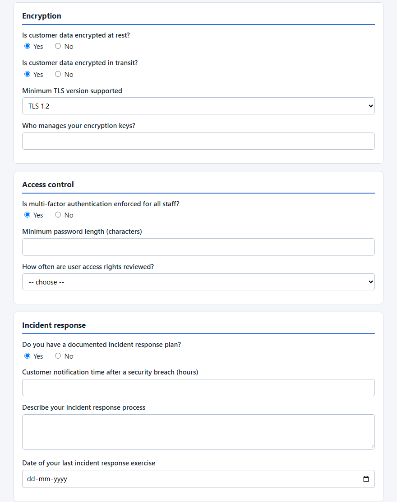
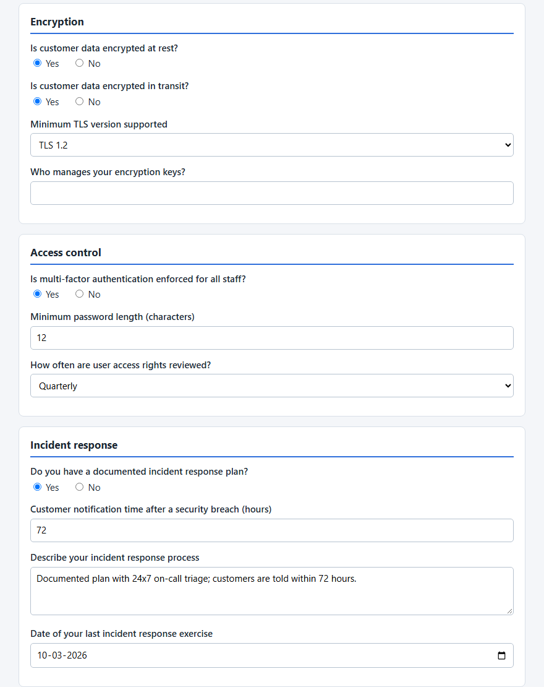
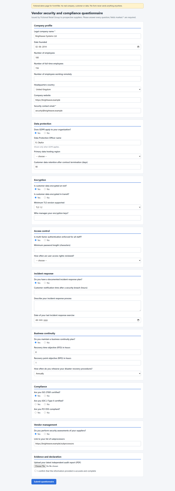
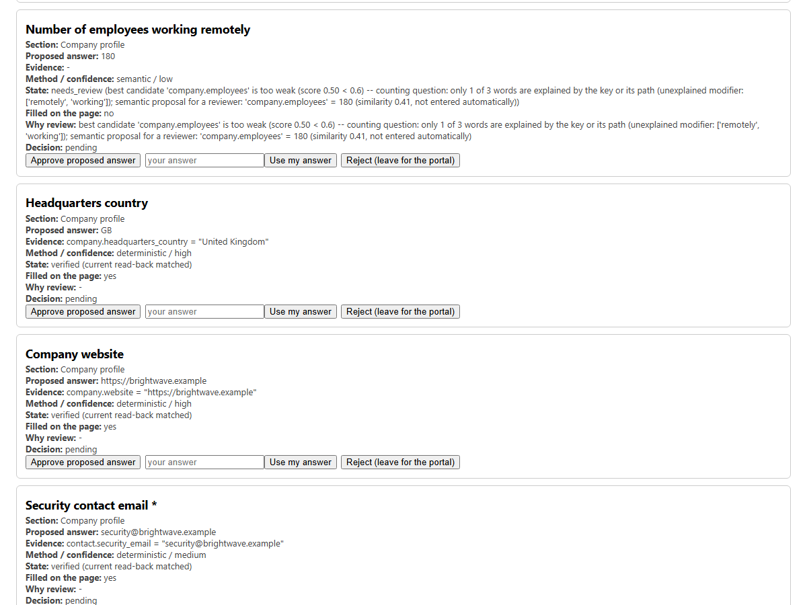
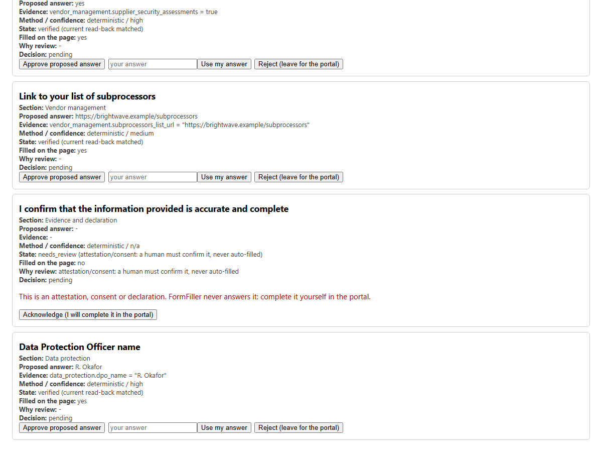
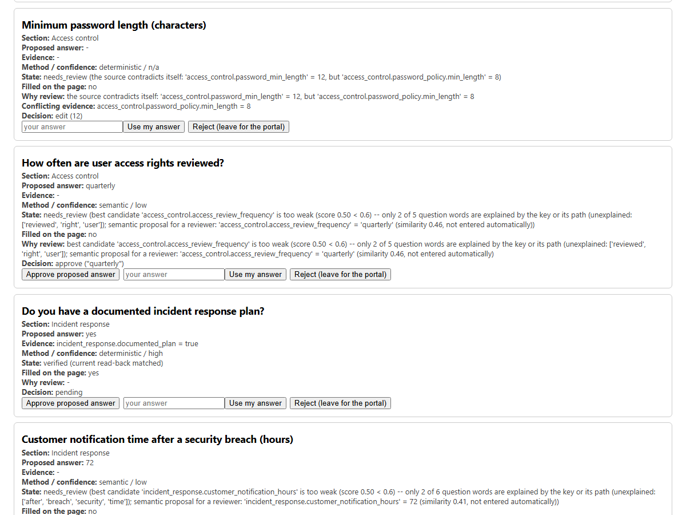

# FormFiller demo guide

A reproducible, local demonstration of FormFiller on a fictional vendor security questionnaire. About 10 minutes to run, 3 minutes
to present ([recording script](RECORDING_SCRIPT.md)).

**Needs:** Python 3.11 or newer, and the Chromium that Playwright installs. **Does not need:** an API key, a network connection
while it runs (the questionnaire is a local file and no LLM is involved), or any real data. Everything is fictional: the company
(`Brightwave Systems Ltd`), its facts, the questionnaire (issued by a fictional "Fictional Retail Group"), and every address uses the
reserved `.example` domain.

> **What this demo is, and is not.** It shows the *workflow* on one hand-written questionnaire and one hand-written source. The
> questionnaire was written to include confident matches, near-misses, missing facts, a contradiction, an attestation and an
> upload, so every behaviour appears. The counts below (22 / 11 / 1) describe this fixture only. They are **not** an accuracy
> figure. The measured results are in the [README](../../README.md#evaluation-results) and, for public pages,
> [`REAL_WORLD_TESTING_REPORT.md`](../../REAL_WORLD_TESTING_REPORT.md).

| Before human review | After human review |
|---|---|
|  |  |

*Both images are the same region of FormFiller's own `filled.png` screenshots, cropped and otherwise unedited. Left: the first run. Right: the run
that applied the reviewer's decisions. The encryption-keys field stays empty because the reviewer rejected the proposal for it.*

## 1. Set up

From the repository root. The demo needs only the `web` extra (Playwright); `dev` adds pytest, ruff, mypy and pip-audit.

```bash
git clone https://github.com/niyabraham/FormFiller.git
cd FormFiller
python -m venv .venv
source .venv/bin/activate              # Windows PowerShell: .venv\Scripts\Activate.ps1   (cmd.exe: .venv\Scripts\activate.bat)
pip install -e ".[web]"                # or ".[dev]" to run the tests as well
playwright install chromium
```

Check it works (optional, about a minute; needs the `dev` extra):

```bash
python -m pytest tests/web/test_demo_rfi.py -q
```

## 2. The materials

| File | What it is |
|---|---|
| [`security_questionnaire.html`](security_questionnaire.html) | A single-page vendor security questionnaire: 33 questions in eight sections (company profile, data protection, encryption, access control, incident response, business continuity, compliance, vendor management) plus an evidence section with a file upload and an accuracy declaration. One question appears only after another is answered. The page submits nothing anywhere. |
| [`company_source.json`](company_source.json) | The fictional company's facts, grouped the way the questionnaire is. Keys resemble the wording of the questions they answer, as the README advises. |

How the demo data was written, so you can judge what it shows:

- Most questions have a fact with a natural key (`encryption.customer_data_encrypted_at_rest`) and are answered confidently.
- Some have **no fact on purpose** (who manages the encryption keys, the date of the last incident-response exercise, PCI DSS status).
- Some have a fact that is an obvious match to a person but not to the matcher: for "Primary data **hosting region**" the source has
  `data_protection.hosting_region`, and the matcher stops at the extra word *primary*, which is not in the key. These get a *proposal* for the reviewer.
- One question is about a different scope than any fact ("employees working **remotely**", while the source has total and full-time headcount).
- The source **contradicts itself** on purpose: `password_min_length` is 12 and `password_policy.min_length` is 8.
- SOC 2 is `in progress`, which is not a certification.
- One question is a declaration ("I confirm that the information provided is accurate and complete") and one is a file upload.

## 3. Run it (the first pass)

```bash
python demo_web.py --form docs/demo/security_questionnaire.html --source docs/demo/company_source.json --out output/demo
```

It takes about seven seconds, opens the page in headless Chromium, and never presses Submit. It prints one line per question, grouped by the
page's own section headings. This is the real output of a run (`STATE` is FormFiller's per-question state; a question is `VERIFIED` only after the
page was read back and matched):

```text
STATE         QUESTION                                        VALUE                           EVIDENCE / REASON
------------------------------------------------------------------------------------------------------------------------------------------------------

[Company profile]
VERIFIED      Legal company name *                            Brightwave Systems Ltd          company.legal_name [high, deterministic]
VERIFIED      Date founded                                    2014-06-02                      company.founded [medium, deterministic]
VERIFIED      Number of employees                             180                             company.employees [high, deterministic]
VERIFIED      Number of full-time employees                   156                             company.full_time_employees [high, deterministic]
NEEDS_REVIEW  Number of employees working remotely                                            proposal, not entered: 180 from company.employees [semantic, low]
VERIFIED      Headquarters country                            GB                              company.headquarters_country [high, deterministic]
VERIFIED      Company website                                 https://brightwave.example      company.website [high, deterministic]
VERIFIED      Security contact email *                        security@brightwave.example     contact.security_email [medium, deterministic]

[Data protection]
VERIFIED      Does GDPR apply to your organization?           yes                             data_protection.gdpr_applies [high, deterministic]
NEEDS_REVIEW  Primary data hosting region                                                     proposal, not entered: eu from data_protection.hosting_region [semantic, low]
VERIFIED      Customer data retention after contract term...  90                              data_protection.retention_days_after_termination [medium, deterministic]
VERIFIED      Data Protection Officer name                    R. Okafor                       data_protection.dpo_name [high, deterministic]

[Encryption]
VERIFIED      Is customer data encrypted at rest?             yes                             encryption.customer_data_encrypted_at_rest [high, deterministic]
VERIFIED      Is customer data encrypted in transit?          yes                             encryption.customer_data_encrypted_in_transit [high, deterministic]
VERIFIED      Minimum TLS version supported                   tls12                           encryption.minimum_tls_version [high, deterministic]
NEEDS_REVIEW  Who manages your encryption keys?                                               proposal, not entered: AES-256 from encryption.at_rest_algorithm [semantic, low]

[Access control]
VERIFIED      Is multi-factor authentication enforced for...  yes                             access_control.mfa_enforced_all_staff [high, deterministic]
NEEDS_REVIEW  Minimum password length (characters)                                            the source contradicts itself: 'access_control.password_min_length' = 12, but 'acce...
NEEDS_REVIEW  How often are user access rights reviewed?                                      proposal, not entered: quarterly from access_control.access_review_frequency [semantic, low]

[Incident response]
VERIFIED      Do you have a documented incident response ...  yes                             incident_response.documented_plan [high, deterministic]
NEEDS_REVIEW  Customer notification time after a security...                                  proposal, not entered: 72 from incident_response.customer_notification_hours [semantic, low]
NEEDS_REVIEW  Describe your incident response process                                         proposal, not entered: 72 from incident_response.customer_notification_hours [semantic, low]
NEEDS_REVIEW  Date of your last incident response exercise                                    no matching value in the source data

[Business continuity]
VERIFIED      Do you maintain a business continuity plan?     yes                             business_continuity.plan_exists [medium, deterministic]
VERIFIED      Recovery time objective (RTO) in hours          8                               business_continuity.rto_hours [high, deterministic]
VERIFIED      Recovery point objective (RPO) in hours         1                               business_continuity.rpo_hours [high, deterministic]
VERIFIED      How often do you rehearse your disaster rec...  annually                        business_continuity.dr_test_frequency [medium, deterministic]

[Compliance]
VERIFIED      Are you ISO 27001 certified?                    yes                             certifications.iso_27001.status [high, status_evidence]
NEEDS_REVIEW  Are you SOC 2 Type II certified?                                                certification/compliance claim: 'certifications.soc2.status' = 'in progress' is not...
NEEDS_REVIEW  Are you PCI DSS compliant?                                                      certification/compliance claim: no evidence about PCIDSS status in the source data

[Vendor management]
VERIFIED      Do you perform security assessments of your...  yes                             vendor_management.supplier_security_assessments [high, deterministic]
VERIFIED      Link to your list of subprocessors              https://brightwave.example/...  vendor_management.subprocessors_list_url [medium, deterministic]

[Evidence and declaration]
NEEDS_REVIEW  I confirm that the information provided is ...                                  attestation/consent: a human must confirm it, never auto-filled

[Controls FormFiller cannot fill - reported, never touched]
UNSUPPORTED   Upload your latest independent audit report...                                  file upload: a person must attach the file; FormFiller never uploads files

22 verified | 11 needs review | 1 unsupported control(s)
Run status: NEEDS_REVIEW
Submission: not attempted. Review the form, then submit it yourself in the portal.
Warning: 1 visible control(s) cannot be filled by FormFiller and were not touched (0 required): Upload your latest independent audit report (PDF) (file_upload); a person must handle them
Artifacts: filled.png, result.json, audit_report.md
```

How to read it:

| Column | Meaning |
|---|---|
| `STATE` | `VERIFIED`: entered, then read back from the page and matched. `NEEDS_REVIEW`: nothing was entered; a person decides. `UNSUPPORTED`: a control FormFiller cannot fill, reported and never touched. |
| `VALUE` | What was entered, in the form the control takes it (the option value `GB` for "United Kingdom", `tls12` for "TLS 1.2"). |
| `EVIDENCE / REASON` | For an answer: the source path, then `[confidence category, method]`. `high` is an exact key match or a stated status, `medium` a partial match above the threshold. For a review item: why it was not answered, or `proposal, not entered`: a similarity hint (`low`) for a person to approve or reject. |

Written next to it in `output/demo/`: `result.json` (every question's state, source, method, confidence, validation, read-back and reason),
`audit_report.md` (the same for a person, with answers optionally redacted) and `filled.png` (a screenshot of the page after the run). All of `output/` is
git-ignored and holds the answers, so treat it as confidential. `--trace` would also record a Playwright trace (`trace.zip`: page content and answers); the demo
does not need one, so it is off.

<details>
<summary>The full-page screenshot FormFiller took (<code>output/demo/filled.png</code>)</summary>



</details>

### Where each stage of the workflow shows up

| # | Stage | Where you see it |
|---|---|---|
| 1 | Load a fictional questionnaire | `--form`: the page is opened in Chromium (a local file) |
| 2 | Load the fictional source | `--source`: the JSON is flattened into facts such as `company.legal_name = "Brightwave Systems Ltd"` (`retrieve.index_source`) |
| 3 | Discover and understand the questions | The `QUESTION` column and section headings. 33 questions plus one unsupported control; the Data Protection Officer question was hidden until the GDPR answer revealed it, and was found in the next round |
| 4 | Match questions to facts | The `EVIDENCE` column: source path, `[confidence, method]` |
| 5 | Proposed answers with confidence and evidence | `VALUE` and `EVIDENCE` for answers; `proposal, not entered` rows for proposals; `result.json` carries `confidence`, `confidence_category`, `method`, `raw_value`, `alternatives`, `conflicts` |
| 6 | Uncertain or unsupported questions handled safely | Eleven `NEEDS_REVIEW` rows, each with a reason, and one `UNSUPPORTED` row. None of them was typed into: look at the left-hand image above |
| 7 | Uncertain answers go to human review | Step 5 below |
| 8 | Validate | Before the browser is touched each candidate is checked against its own control (`validate.py`): `TLS 1.2` becomes the option `tls12`, a date must be ISO, a value that does not fit goes to review. The review page applies the same check to what a person types |
| 9 | Safe filling | Only `ANSWER` items are entered, with Playwright actions (fill, select, check), never by page script. `filled.png` shows the result |
| 10 | Read-back | `VERIFIED` means the control was read back after a one-second confirmation window and matched. `result.json` has `observed`, `verified` and the browser's own `browser_valid` |
| 11 | Human approval before submission | The status stays `NEEDS_REVIEW`, `Submission: not attempted`; the review page has no submit control; step 6 shows a requested submission being refused |

## 4. Look at the evidence

Two real entries from `output/demo/result.json` (trimmed to the relevant fields). The first is an answer that was transformed, entered and read back; the second is a
question that was **not** answered and was given a proposal instead:

```json
[
  {
    "plan": {
      "question": "Minimum TLS version supported",
      "status": "ANSWER",
      "source": "encryption.minimum_tls_version",
      "raw_value": "TLS 1.2",
      "answer": "tls12",
      "confidence": 1.0,
      "confidence_category": "high",
      "method": "deterministic",
      "validation": "ok",
      "reason": null,
      "proposed_answer": null
    },
    "filled": true,
    "observed": "tls12",
    "verified": true,
    "browser_valid": true,
    "state": "verified"
  },
  {
    "plan": {
      "question": "Primary data hosting region",
      "status": "REVIEW",
      "source": null,
      "raw_value": null,
      "answer": null,
      "confidence": 0.5,
      "confidence_category": "low",
      "method": "semantic",
      "validation": null,
      "reason": "best candidate 'data_protection.hosting_region' is too weak (score 0.50 < 0.6) -- question scope ['primary'] is not in the key or its path; semantic proposal for a reviewer: 'data_protection.hosting_region' = 'EU' (similarity 0.75, not entered automatically)",
      "proposed_answer": "eu"
    },
    "filled": false,
    "observed": "",
    "verified": null,
    "browser_valid": true,
    "state": "needs_review"
  }
]
```

`audit_report.md` opens with the same information as counts:

```text
## Counts

| measure | count |
|---|---|
| questions | 33 |
| filled (entered) | 22 |
| state: proposed | 0 |
| state: entered | 0 |
| state: verified | 22 |
| state: rejected | 0 |
| state: skipped | 0 |
| state: needs_review | 11 |
| browser-invalid after filling | 0 |
| blocked requests | 0 |
| required still open | 0 |
| attestations / consents (never answered) | 1 |
| unsupported controls (not touched) | 1 |
```

Note what `state: needs_review` and `filled: false` mean for the second entry: the proposal (`eu`) was shown to a person and the field was left empty.

## 5. Human review

```bash
python -m formfill.web.review_server output/demo/result.json --build
```

It prints a line like `Review page (local only; keep the token private): http://127.0.0.1:52134/?token=...`. Open that exact URL. The page listens on `127.0.0.1` only, needs the
random token, and says at the top that reviewing is not submitting and approving is not a signature. Every question is listed with its section, proposed
answer, evidence, method and confidence, state, whether it was filled, and why it needs review.

| A question that was not answered: the scope guard refused the headcount, and only a low-confidence proposal is offered | A declaration: the only action offered is to say you will complete it yourself |
|---|---|
|  |  |

Make these decisions (any subset works; the buttons are on each card):

| Question | Decision | Why |
|---|---|---|
| Primary data hosting region | **Approve proposed answer** (`eu`) | The proposal is right |
| How often are user access rights reviewed? | **Approve proposed answer** (`quarterly`) | Right |
| Customer notification time after a security breach (hours) | **Approve proposed answer** (`72`) | Right |
| Who manages your encryption keys? | **Reject** | The proposal (`AES-256`) is a similarity hint, not an answer to this question |
| Number of employees working remotely | **Use my answer**: `62` | The source has no such fact; you know it |
| Minimum password length (characters) | **Use my answer**: `12` | You resolve the contradiction |
| Describe your incident response process | **Use my answer**: any sentence | The proposal (`72`) does not answer a narrative question |
| Date of your last incident response exercise | **Use my answer**: `2026-03-10` | Try `next Tuesday` first: the page refuses it (see below) |
| Are you SOC 2 Type II certified? | **Reject** | The source says `in progress`; the portal decides |
| Are you PCI DSS compliant? | **Reject** | No evidence |
| I confirm that the information provided is accurate and complete | **Acknowledge** | The only choice offered: you will complete it in the portal |

Things the review page enforces, which you can check by trying them:

- A typed value is validated against the field: `next Tuesday` for the date is refused with
  `not a valid answer for this field: 'next Tuesday' is not an ISO date (YYYY-MM-DD)`.
- A declaration cannot be approved or edited, by the page or by the code behind it: `an attestation, consent or declaration is never answered by FormFiller; mark it 'acknowledge' and complete it yourself in the portal`.
- Decisions are saved to `output/demo/review.json`. Stop the server with Ctrl+C. (Running `--build` again would create a fresh review file and discard your decisions; to reopen
  them, run `python -m formfill.web.review_server output/demo/review.json` without `--build`.)



*The review page after those decisions (captured from the running page): both conflicting facts are shown for the password question, and the decisions are recorded on each card.*

## 6. Apply the decisions, and the final step stays with a person

```bash
python demo_web.py --form docs/demo/security_questionnaire.html --source docs/demo/company_source.json --out output/demo-reviewed --review output/demo/review.json
```

FormFiller runs again on a fresh page. Decisions are re-validated, entered, and **read back like every other answer**. Only the changed rows are shown here, the full table has the same shape:

```text
STATE         QUESTION                                        VALUE                           EVIDENCE / REASON
------------------------------------------------------------------------------------------------------------------------------------------------------
VERIFIED      Number of employees working remotely            62                              typed by the reviewer [human_edited]
VERIFIED      Primary data hosting region                     eu                              approved by the reviewer (proposal from data_protection.hosting_region) [human_approved]
NEEDS_REVIEW  Who manages your encryption keys?                                               rejected by the reviewer: to be completed in the portal by a person
VERIFIED      Minimum password length (characters)            12                              typed by the reviewer [human_edited]
VERIFIED      How often are user access rights reviewed?      quarterly                       approved by the reviewer (proposal from access_control.access_review_frequency) [human_approved]
VERIFIED      Customer notification time after a security...  72                              approved by the reviewer (proposal from incident_response.customer_notification_hours) [human_approved]
VERIFIED      Describe your incident response process         Documented plan with 24x7 o...  typed by the reviewer [human_edited]
VERIFIED      Date of your last incident response exercise    2026-03-10                      typed by the reviewer [human_edited]
NEEDS_REVIEW  Are you SOC 2 Type II certified?                                                rejected by the reviewer: to be completed in the portal by a person
NEEDS_REVIEW  Are you PCI DSS compliant?                                                      rejected by the reviewer: to be completed in the portal by a person
NEEDS_REVIEW  I confirm that the information provided is ...                                  attestation/consent: a human must confirm it, never auto-filled; the reviewer will ...

29 verified | 4 needs review | 1 unsupported control(s)
Run status: NEEDS_REVIEW
Submission: not attempted. Review the form, then submit it yourself in the portal.
```

That is seven more answers (three approved proposals and four typed by the reviewer), 29 in all. Four questions are still with the person: the rejected encryption-keys, SOC 2 and PCI DSS
questions, and the declaration. The upload is untouched. The run status is still `NEEDS_REVIEW` and nothing was submitted. The person finishes those in the portal, checks the form, and presses
Submit themselves.

**What if you ask it to submit?** The default never does, and the review page has no submit control. Callers can opt in with `submit=True` (`--submit` here), and FormFiller still refuses while a
declaration is open, an answer failed, a required question needs review, or an unsupported control has no explicit human decision. On the local fictional page:

```bash
python demo_web.py --form docs/demo/security_questionnaire.html --source docs/demo/company_source.json --out output/demo-submit --submit
```

```text
22 verified | 11 needs review | 1 unsupported control(s)
Run status: NEEDS_REVIEW
Submission: {'attempted': False, 'outcome': 'SKIPPED', 'detail': '1 item(s) require human review, 0 answer(s) not entered or failed verification, 0 required control(s) cannot be filled by FormFiller, 1 optional unsupported control(s) lack an explicit human decision (pass their ack_id in acknowledge_unsupported to proceed; a control whose ack_id is null is ambiguous and cannot be acknowledged)'}
```

The Submit button is not pressed. (Optional questions left in review do not, by themselves, block an explicit `submit=True`; required ones, declarations, failed answers and unsupported
required controls do. See the [README's safety section](../../README.md#safety-and-human-in-the-loop-design).)

## 7. Known limitations seen while preparing this demo

Listed because a demo that hides them would be less credible:

1. **Proposals can be wrong.** Three of the six proposals in the first run do not answer their question: `AES-256` for "Who manages your encryption keys?", `72` for a narrative
   question, `180` for "employees working remotely". That is why a proposal is only ever *shown* to a person and never entered, and why the review step exists.
2. **Neighbouring concepts are guarded, not eliminated.** The questionnaire asks for both the recovery *time* objective (RTO) and the recovery *point* objective (RPO), and the source holds both, so
   each is answered from its own fact. This used to be a real weakness: with the RPO fact deleted, the RPO question was answered with the RTO value, `8` (match score 0.87, category `medium`),
   because the two questions share most of their words. It was found while preparing this demo and fixed in PR #27; a test pins the fixed behaviour. To see it, make a copy of the source without the
   RPO fact and run the demo on it (works in any shell; the copy goes in the git-ignored `output/` folder):

   ```bash
   python -c "import json,pathlib; d=json.load(open('docs/demo/company_source.json',encoding='utf-8')); del d['business_continuity']['rpo_hours']; pathlib.Path('output').mkdir(exist_ok=True); json.dump(d,open('output/source_no_rpo.json','w',encoding='utf-8'),indent=2)"
   python demo_web.py --form docs/demo/security_questionnaire.html --source output/source_no_rpo.json --out output/demo-no-rpo
   ```

   Expected: `21 verified | 12 needs review | 1 unsupported control(s)`, and the RPO row is `NEEDS_REVIEW` (the RTO row stays `VERIFIED`), with the reason
   `best candidate 'business_continuity.rto_hours' is too weak (score 0.50 < 0.6) -- different concept: the question says ['point'] where the key says ['time']`. The guard looks for a pair of
   phrases that differ by one word; it does not understand the concepts, so a pair that differs in a more complicated way can still be confused. The evidence and its limits are in the
   [README](../../README.md#neighbouring-concepts-pr-27-regression-probes-and-what-else-changed).
3. **Wording matters.** The matcher compares words, so `notify` and `notification`, `apply` and `applicable`, or `sub-processor` (split into two words) and `subprocessor` do not
   match. Those cases fail safe (they go to review), and the demo's wording was aligned in a few places so that the confident matches are visible. Real portals will differ.
4. **One page, one browser.** The demo is a single page in headless Chromium. The network guard belongs to multi-step walks and is not exercised here; see the
   [security model](../SECURITY_MODEL.md) and the [architecture](../ARCHITECTURE.md#9-network-safety-scope).
5. **Not a measurement.** The counts describe this fixture. For measured precision and coverage, and for what was tried on public pages, use the README's evaluation section.

## 8. Troubleshooting

| Symptom | Fix |
|---|---|
| `Executable doesn't exist at ...` (Playwright's message when its browser is missing) | `playwright install chromium`. To use a Chromium you already have, set `FORMFILL_CHROMIUM` to its path. |
| PowerShell refuses to run `Activate.ps1` | `Set-ExecutionPolicy -Scope Process RemoteSigned`, or use `.venv\Scripts\activate.bat` in `cmd.exe`. |
| `ModuleNotFoundError: formfill` | Run from the repository root with the virtual environment active and `pip install -e ".[web]"` done. |
| The review page says `forbidden` | Open the full URL printed at start, including `?token=...`. Each start prints a new token; `localhost` and `127.0.0.1` work, other hosts do not. |
| `Address already in use` for the review page | Pick a port: `python -m formfill.web.review_server output/demo/review.json --port 8765`. |
| The counts differ from this guide | Compare Playwright and Chromium versions (this guide was produced with Playwright 1.64.1 and Chromium 156), then run `python -m pytest tests/web/test_demo_rfi.py -q`, which pins the outcomes quoted here. |
| `JSONDecodeError: Unexpected UTF-8 BOM` when you edited the source | The loader reads plain UTF-8. Windows PowerShell 5.1's `Set-Content -Encoding utf8` adds a byte-order mark; write the copy with the Python one-liner in section 7 or save as "UTF-8" without BOM. |
| `PermissionError: [WinError 5]` mentioning `trace.zip` | Only with `--trace`, on Windows, when another process (often antivirus) briefly holds the freshly written trace. Run again, or leave `--trace` off; the demo does not need it. |
| `UnicodeEncodeError` when running `python demo.py` with redirected output on Windows | That is the older PDF demo, which prints non-ASCII characters; set `PYTHONUTF8=1`. `demo_web.py` prints ASCII only. |
| You want to start again | Delete `output/demo`, `output/demo-reviewed` and `output/demo-submit`. They hold answers; they are git-ignored. |

## 9. About the screenshots

All images in [`../assets`](../assets) are real captures from this demo, taken on 1 November 2026 on Windows 11 with Python 3.12, Playwright 1.64.1 and Chromium 156. The two
`demo-*-review` images and the full-page image are crops or copies of FormFiller's own `filled.png`. The `review-page-*` images are screenshots of the review page served by
`formfill.web.review_server`; to get the "after decisions" state without clicking by hand, a short script drove the page's own buttons with the decisions in the table above. Nothing was
drawn, retouched or mocked up. Terminal output is quoted as text rather than as an image so that it can be copied.
